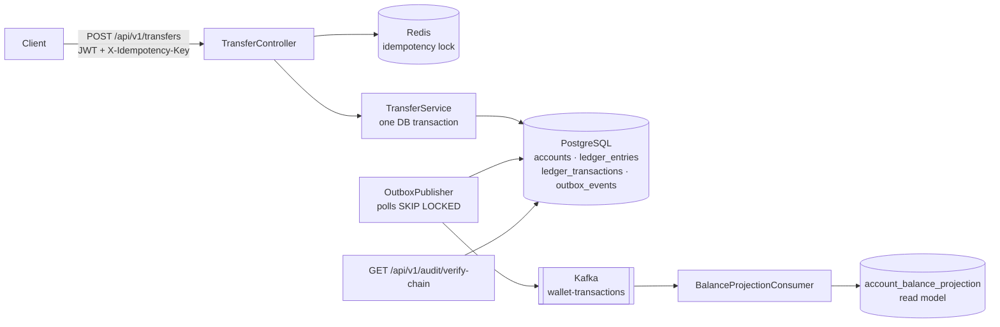

# Wallet: a double-entry ledger service

[](https://github.com/anandm05/wallet/actions/workflows/ci.yml)

**[Try the UI demo →](https://anandm05.github.io/wallet/)** It runs in your browser with sample data, and no sign-in is needed.

A money-movement backend built the way payment systems need to behave: every
transfer is a balanced double-entry transaction, retries can never double-charge,
events reach Kafka exactly when the database commit happens, and the ledger is
tamper-evident.

**Stack:** Java 17 · Spring Boot 4 · PostgreSQL 16 · Flyway · Apache Kafka (KRaft) ·
Redis · Spring Security (OAuth2/JWT, AWS Cognito) · Docker Compose · Testcontainers ·
GitHub Actions · deployed on AWS EC2 · React + TypeScript UI

## Architecture



One write path, `TransferService.postTransaction`, does all of the following in a
single `@Transactional` method: it validates that the legs balance, locks every
touched account in a fixed order, updates balances, extends the hash chain and
writes an outbox row.

## Problems it solves, and how

| Problem | How this service handles it | Where |
|---|---|---|
| **Duplicate charges from client retries** | Redis lock on `X-Idempotency-Key` as the fast path. A Postgres unique constraint on `ledger_transactions.idempotency_key` is the real guarantee. If Redis forgot the key, the original result is replayed instead of a second charge. | `IdempotencyInterceptor`, `IdempotencyService`, `TransferController` |
| **Money created or lost by a bug** | Double-entry ledger: every transaction has at least one debit and one credit. A `DEFERRABLE` constraint trigger rejects any commit whose legs don't sum to zero, even if application code is wrong. | `V3__double_entry_ledger.sql`, `V5__balance_constraint_trigger.sql` |
| **Deadlocks under concurrent transfers** | Accounts are locked in sorted order of their reference, so two transfers touching the same accounts can't wait on each other. | `TransferService` |
| **Kafka and DB out of sync (dual write)** | Transactional outbox: the event row commits with the ledger change, and a scheduled publisher (`FOR UPDATE SKIP LOCKED`, exponential backoff, 5 attempts) delivers it to Kafka. | `V4__outbox_events.sql`, `OutboxPublisher` |
| **Slow balance reads at scale** | CQRS read model: a Kafka consumer maintains an eventually consistent balance projection. | `BalanceProjectionConsumer`, `V6__balance_projection.sql` |
| **Silent tampering with history** | `ledger_entries` is append-only (a trigger blocks `UPDATE`/`DELETE`, even for a superuser), and each entry carries a SHA-256 hash of the previous one. `verify-chain` replays and checks the whole chain. | `HashChainService`, `ChainVerificationService` |
| **Unauthorised access** | OAuth2 resource server with JWTs from AWS Cognito. Admin endpoints need the `wallet-api/admin` scope. Admin top-ups go through the same double-entry path from a treasury account, not a special unaudited credit. | `SecurityConfig`, `AdminController`, `V8__system_treasury_account.sql` |

## API

All endpoints are under `/api/v1` and need a bearer token.

| Method | Path | Purpose |
|---|---|---|
| `POST` | `/transfers` | Post a balanced multi-leg transaction (needs `X-Idempotency-Key`) |
| `GET` | `/accounts`, `/accounts/{ref}` | List accounts, or get one |
| `POST` | `/accounts` | Create an account |
| `GET` | `/accounts/{ref}/entries` | Ledger history for an account |
| `GET` | `/accounts/{ref}/projection` | Balance from the Kafka-fed read model |
| `GET` | `/audit/verify-chain` | Recompute and verify the hash chain |
| `POST` | `/admin/accounts/{ref}/mint` | Fund an account from the treasury (admin scope) |
| `GET` | `/admin/transactions` | All transactions (admin scope) |

Example transfer:

```bash
curl -X POST http://localhost:8080/api/v1/transfers \
  -H "Authorization: Bearer $TOKEN" \
  -H "X-Idempotency-Key: $(uuidgen)" \
  -H "Content-Type: application/json" \
  -d '{
        "description": "rent",
        "entries": [
          {"accountRef": "alice", "direction": "DEBIT",  "amount": 100.00},
          {"accountRef": "bob",   "direction": "CREDIT", "amount": 100.00}
        ]
      }'
```

## UI

`ui/` is a React + TypeScript (Vite) front end with four screens:

- **Accounts:** balances, ledger history with entry hashes, and the Kafka-fed projection
  shown next to the ledger balance so you can watch it catch up.
- **Transfer:** posts a balanced debit/credit pair with a generated idempotency key, plus a
  "retry with the same key" button that shows the server returning the original
  transaction instead of charging twice.
- **Audit:** runs `verify-chain`. In demo mode you can also edit a stored amount and watch
  verification catch it.
- **Admin:** funds accounts from the treasury and lists all transactions. It's only shown
  to users with the `wallet-api/admin` scope.

Sign-in is OAuth2 Authorization Code + PKCE against the Cognito hosted UI, and the access
token is sent as a bearer token to the API. **Demo mode** runs a faithful in-browser copy of
the rules (balanced legs, no overdraft, idempotent replay, SHA-256 hash chain, a lagging
projection), so the UI can be tried without AWS. That is what the demo link above serves.

```bash
cd ui
cp .env.example .env.local   # API URL, Cognito domain and the wallet-ui client ID
npm install
npm run dev                  # http://localhost:3000
```

## Tests

`mvn test` runs the unit tests and integration tests against real Postgres, Kafka
and Redis containers (Testcontainers), not H2 or mocks:

- **`IdempotencyConcurrencyIT`** fires 50 truly concurrent requests with the same
  idempotency key and asserts exactly one transaction, two ledger entries and one
  balance movement.
- **`BalancedTransactionTriggerIT`** proves the database itself rejects an
  unbalanced transaction at commit.
- **`AppendOnlyLedgerIT`** proves ledger rows can't be updated or deleted.
- **`AccountApiIT`** runs the flow the UI uses end to end: create accounts, fund from
  the treasury, transfer, then read history, the Kafka-fed projection and `verify-chain`.
- **`HashChainServiceTest`** covers hash computation and chain verification.

CI (GitHub Actions) runs the full suite and builds the Docker image on every push.

## Run it locally

Needs Docker and JDK 17. JDK 25 breaks Lombok code generation here.

```bash
echo "POSTGRES_PASSWORD=change-me" > .env
docker compose up -d --build     # Postgres, Redis, Kafka (KRaft) and the app on :8080
mvn test                         # full test suite (Docker must be running)
```

The Compose file builds from the parent directory (`context: ..`), so clone the repo
into a folder named `wallet`.

## Deployment

The service runs on a single AWS EC2 `t3.micro` (1 GB RAM) with Docker Compose.
Every service has resource caps, Kafka runs single-node KRaft with a capped heap
and 48-hour retention, and only port 8080 is published. Postgres, Redis and Kafka
are reachable only on the internal Compose network. `infra/deploy.sh` checks the
security group against your current IP and the disk, backs up any drifted state
on the server, then deploys the pushed `main` commit.

## Design notes

- **Schema history is immutable.** Flyway migrations V1–V8 include a mid-project
  redesign from single-entry to double-entry (V3). Fixes go forward in new
  migrations and never edit old ones.
- **The database is the last line of defence.** Balance and append-only rules
  live in triggers, so a bug in application code can't break the ledger's
  invariants.
- **Hash inputs match what the database stores.** Timestamps are truncated to
  microseconds and amounts are normalised to 2 decimal places before hashing
  (a request for `500` is stored as `500.00`). Otherwise verification would flag
  untouched rows as tampered. `AccountApiIT` caught the amount case.

## Known gaps

- No TLS yet; the API serves plain HTTP.
- Secrets live in a `.env` file, not AWS Secrets Manager or SSM.
- Still to do: reversals and refunds, reconciliation jobs, metrics and dashboards,
  and multi-currency support.
